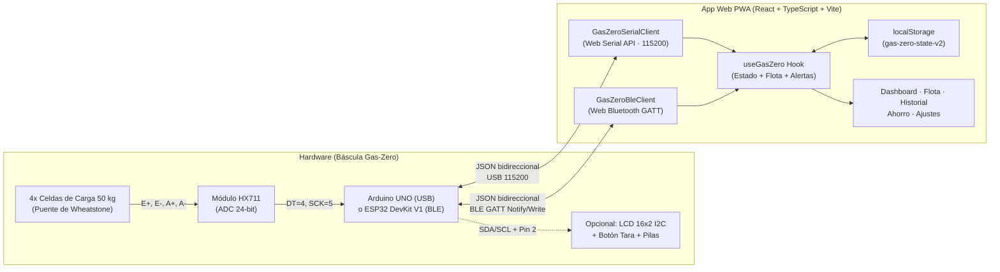

# Documentación Técnica Completa — Proyecto Gas-Zero

Documentación integral de arquitectura, hardware, firmware, protocolo de comunicaciones, aplicación web React/TypeScript, despliegue en producción y control de calidad para fabricación/venta de **Gas-Zero**.

---

## 1. Visión General y Arquitectura

**Gas-Zero** es un sistema IoT de monitoreo de cilindros de gas (`N₂`, `Ar`, `CO₂`, `O₂`, `LP`) compuesto por:

1. **Plataforma física de pesaje:** 4 celdas de carga de medio puente de 50 kg (200 kg combinados) conectadas en puente completo de Wheatstone a un conversor ADC de 24 bits **HX711**.
2. **Microcontrolador (dos variantes soportadas):**
   * **Arduino UNO (USB · Web Serial a 115200 baudios):** ideal para estaciones con PC/laptop cercana, con soporte opcional para pantalla **LCD 16x2 I2C**, botón físico de tara y alimentación por pilas (6×AA o 2×18650).
   * **ESP32 DevKit V1 (Bluetooth BLE GATT):** operación inalámbrica hacia Android o escritorio con ahorro energético y pantalla LCD I2C opcional.
3. **Aplicación Web Progresiva (PWA):** desarrollada en **React 18 + TypeScript + Vite**, desplegada en HTTPS (Netlify/Vercel) sin necesidad de backend ni base de datos externa (persistencia local en `localStorage` y calibración persistente en EEPROM/NVS del hardware).



---

## 2. Estructura del Repositorio

```text
Gas-Zero/
├── index.html                           # Punto de entrada HTML + fuentes Inter / JetBrains Mono
├── package.json                         # Dependencias y scripts (dev, build, preview)
├── netlify.toml                         # Configuración de build y SPA redirects para Netlify
├── vite.config.ts                       # Configuración de Vite + plugin React
├── tsconfig.json / tsconfig.app.json    # Configuración estricta de TypeScript
├── public/
│   ├── icon.svg                         # Ícono vectorial PWA
│   └── manifest.webmanifest             # Manifiesto PWA (instalable en escritorio y móvil)
├── docs/
│   ├── DOCUMENTACION_TECNICA.md         # Este documento (arquitectura, protocolo, despliegue y QC)
│   └── MANUAL_DE_USUARIO_CLIENTE.md     # Manual paso a paso para clientes finales sin conocimientos técnicos
├── firmware/
│   ├── GUIA_HARDWARE_Y_CONEXIONES.md    # Lista de compras (BOM) y diagrama detallado de armado
│   ├── gas_zero_uno/
│   │   └── gas_zero_uno.ino             # Firmware oficial Arduino UNO v1.1.0 (USB + EEPROM + LCD/Botón opcional)
│   ├── gas_zero_esp32/
│   │   └── gas_zero_esp32.ino           # Firmware oficial ESP32 v1.0.0 (BLE GATT + NVS + LCD opcional)
│   └── calibracion_hx711/
│       └── calibracion_hx711.ino        # Utilidad de calibración rápida para ESP32
└── src/
    ├── main.tsx                         # Montaje de React
    ├── App.tsx                          # Shell principal, barra en vivo USB/BLE, sidebar y rutas por pestaña
    ├── index.css                        # Hoja de estilos completa (tema oscuro con acentos dinámicos por gas)
    ├── types/
    │   ├── gas.ts                       # Tipos del dominio (CylinderState, Esp32TelemetryPayload, etc.)
    │   ├── web-serial.d.ts              # Declaraciones TypeScript para Web Serial API
    │   └── web-bluetooth.d.ts           # Declaraciones TypeScript para Web Bluetooth API
    ├── constants/
    │   ├── gases.ts                     # Catálogo de gases (N2, Ar, CO2, O2, LP) y presets de tanques
    │   └── ble.ts                       # UUIDs BLE GATT y esquema de comandos JSON
    ├── services/
    │   ├── serialService.ts             # Cliente Web Serial (conexión, auto-reconexión, lectura/escritura)
    │   ├── bleService.ts                # Cliente Web Bluetooth + parser tolerante parseEsp32Json()
    │   └── alertService.ts              # Alertas sonoras (Web Audio API) y Notification API
    ├── hooks/
    │   └── useGasZero.ts                # Estado centralizado, persistencia, telemetría y comandos hardware
    └── components/
        ├── HeaderBar.tsx                # Cabecera con título del cilindro, silencio y estado de enlace
        ├── GaugeCard.tsx                # Medidor circular SVG, cilindro animado y métricas principales
        ├── QuickActions.tsx             # Botón principal Tarear (0 kg), calibración rápida y laboratorio demo
        ├── GasTankSelector.tsx          # Selector de tipo de gas, presets de tanque y tara/capacidad manual
        ├── Esp32Console.tsx             # Panel de telemetría en vivo del Arduino/ESP32 + JSON + consola
        ├── FleetView.tsx                # Gestión multi-cilindro (alta, selección, eliminación, resumen)
        ├── HistoryView.tsx              # Gráfica de barras, KPIs, eventos y exportación a CSV
        ├── TipsView.tsx                 # Consejos de ahorro y seguridad según el gas activo
        └── SettingsBleView.tsx          # Conexión USB/BLE, calibración, umbrales, alertas y UUIDs
```

---

## 3. Protocolo de Comunicación (Hardware ↔ App Web)

Tanto la conexión **USB Web Serial** (`115200 baudios`, líneas terminadas en `\n`) como **BLE GATT** comparten el mismo contrato JSON.

### 3.1 Telemetría (Hardware → App Web)

Emitida periódicamente (cada `800 ms` en Arduino UNO; cada `1500 ms` conectado / `4000 ms` en espera en ESP32):

```json
{
  "weight": 24.50,
  "tare": 12.00,
  "net": 12.50,
  "pct": 63,
  "gas": "N2",
  "capacity": 20.00,
  "raw": 558600,
  "factor": 22800.00,
  "hxOk": true,
  "uptime": 145
}
```

| Campo | Tipo | Obligatorio | Descripción |
|---|---|---|---|
| `weight` | `number` | Sí | Peso bruto total sobre la plataforma (kg). |
| `tare` | `number` | Sí | Tara del cilindro vacío configurada en el microcontrolador (kg). |
| `net` | `number` | Sí | Gas neto calculado `max(0, weight - tare)` (kg). |
| `pct` | `number` | Sí | Porcentaje de gas restante `0..100`. |
| `gas` | `string` | Sí | Código de gas: `"N2"`, `"Ar"`, `"CO2"`, `"O2"` o `"LP"`. |
| `capacity` | `number` | Opcional | Capacidad nominal del tanque almacenada en EEPROM (kg). |
| `raw` | `number` | Opcional | Conteo crudo del HX711 respecto al cero (`scale.get_value()`). |
| `factor` | `number` | Opcional | Factor de calibración actual guardado en EEPROM. |
| `hxOk` | `boolean` | Opcional | `true` si el HX711 respondió correctamente en el ciclo actual. |
| `uptime` | `number` | Opcional | Segundos transcurridos desde el encendido del Arduino (`millis() / 1000`). |

> **Compatibilidad retroactiva:** `parseEsp32Json()` en `src/services/bleService.ts` acepta paquetes con solo los 5 campos base (`weight`, `tare`, `net`, `pct`, `gas`) y muestra los 5 campos extendidos cuando el firmware v1.1.0+ los envía.

### 3.2 Comandos (App Web → Hardware)

Enviados como JSON de una sola línea terminada en `\n`:

| Comando | Payload JSON | Acción en el microcontrolador |
|---|---|---|
| **Tarear (0 kg)** | `{"cmd":"TARE"}` | Ejecuta `scale.tare(12)`, reinicia el filtro EMA y envía telemetría inmediata. |
| **Forzar lectura** | `{"cmd":"READ_NOW"}` | Ejecuta lectura del HX711 y emite JSON inmediato. |
| **Sincronizar tanque** | `{"cmd":"SET_CONFIG","gas":"LP","tare":12,"capacity":20}` | Actualiza gas, tara y capacidad, guarda en EEPROM/NVS y emite JSON. |
| **Calibrar** | `{"cmd":"CALIBRATE","knownWeightKg":10.0}` | Calcula `scaleFactor = rawUnits / knownWeightKg`, guarda en EEPROM/NVS y emite JSON. |

### 3.3 Comandos de Mantenimiento por Monitor Serie (Arduino IDE · 115200 baudios)

| Comando | Descripción |
|---|---|
| `T` | Aplica tara en cero (`0.00 kg`) con la báscula vacía. |
| `R` | Fuerza una lectura inmediata. |
| `C 10.0` | Calibra usando un peso conocido de `10.0 kg` colocado sobre la báscula. |
| `F 22800` | Guarda manualmente un factor de escala específico en EEPROM. |

### 3.4 Contrato BLE GATT (Solo versión ESP32)

* **Prefijo de nombre:** `GasZero` (por defecto `GasZero-001`)
* **Service UUID:** `4fafc201-1fb5-459e-8fcc-c5c9c331914b`
* **Telemetry Characteristic (Notify):** `beb5483e-36e1-4688-b7f5-ea07361b26a8`
* **Command Characteristic (Write):** `6e400002-b5a3-f393-e0a9-e50e24dcca9e`

---

## 4. Detalles de Firmware

### 4.1 Arduino UNO (`firmware/gas_zero_uno/gas_zero_uno.ino` · v1.1.0)

* **Librerías requeridas:**
  * `HX711 Arduino Library` by **Bogdan Necula** *(obligatoria)*.
  * `LiquidCrystal I2C` by **Frank de Brabander** *(solo si se activa `#define USE_LCD_I2C 1`)*.
* **Filtrado de señal:** promediado de `6` muestras HX711 + filtro paso bajo exponencial (`EMA_ALPHA = 0.40`) con salto instantáneo ante cambios `> 0.5 kg` para respuesta rápida al colocar/retirar cilindros.
* **Persistencia en EEPROM:** estructura `StoredConfig` validada por firma mágica `0x475A5531` (`"GZU1"`). Conserva `scaleFactor`, `cylinderTareKg`, `capacityKg` y `gasCode` al apagar o desconectar.
* **Botón físico de tara:** pin digital `2` en modo `INPUT_PULLUP` (conectar botón entre Pin `2` y `GND`), con antirrebote de `1.2 s`.
* **Reinicio automático por USB (DTR):** al abrir el puerto serial desde el navegador, Arduino UNO se reinicia (~1.6 s). La app web espera `2000 ms` tras abrir el puerto antes de enviar `SET_CONFIG`.

### 4.2 ESP32 (`firmware/gas_zero_esp32/gas_zero_esp32.ino` · v1.0.0)

* **Almacenamiento permanente:** `Preferences` (NVS).
* **Ahorro de energía:** pone el HX711 en `power_down()` entre lecturas y soporta operación con batería 18650.
* **Pantalla opcional:** `#define USE_LCD_I2C 1` en pines I2C `SDA = GPIO 21`, `SCL = GPIO 22`.

---

## 5. Hardware, Conexiones y Diagnóstico

Consulta también la guía ilustrada paso a paso en [`firmware/GUIA_HARDWARE_Y_CONEXIONES.md`](../firmware/GUIA_HARDWARE_Y_CONEXIONES.md).

### 5.1 Puente de Wheatstone (4 Celdas de Carga de 50 kg)

Vista superior con 4 esquinas (`C1` arriba-izq, `C2` arriba-der, `C3` abajo-izq, `C4` abajo-der):

* **Cables centrales (normalmente Rojos) → HX711 en diagonal:**
  * `C1` → `E+` · `C4` → `E-` · `C2` → `A+` · `C3` → `A-`
* **Cables exteriores (empalmados entre sí, no van al HX711):**
  * Negros horizontales: `C1 ↔ C2` y `C3 ↔ C4`
  * Blancos verticales: `C1 ↔ C3` y `C2 ↔ C4`

> **Nota importante de manufactura (kits económicos):** algunas celdas traen invertido el orden físico de los colores de cable en las pistas bajo la silicona. Verifica siempre con multímetro en `2k Ω`: el cable que marca **~1 kΩ** contra los otros dos es el **centro real** (el que va al HX711); los otros dos marcan **~2 kΩ** entre sí. Al presionar cada celda individualmente, las 4 deben mover el valor crudo hacia el **mismo signo**; si una celda se mueve en sentido contrario, intercambia sus dos cables exteriores.

### 5.2 Pinout Completo — Arduino UNO

| Periférico | Pin del módulo | Pin en Arduino UNO | Notas |
|---|---|---|---|
| **HX711** | `VCC` | `5V` | Compartible con LCD |
| **HX711** | `GND` | `GND` | — |
| **HX711** | `DT` (DOUT) | `D4` | — |
| **HX711** | `SCK` (PD_SCK) | `D5` | — |
| **LCD 16x2 I2C** *(opcional)* | `VCC` / `GND` | `5V` / `GND` | Ajustar potenciómetro azul trasero de contraste |
| **LCD 16x2 I2C** *(opcional)* | `SDA` / `SCL` | `A4` / `A5` | Dirección habitual `0x27` (o `0x3F`) |
| **Botón Tara** *(opcional)* | Terminal 1 / 2 | `D2` / `GND` | Usa `INPUT_PULLUP` interno |
| **Alimentación autónoma** | `+` / `-` | **Jack DC** o `VIN` / `GND` | **6×AA (9V)** o **2×18650 (7.4V)** con interruptor ON/OFF |

> **Regla de seguridad para ESP32:** en ESP32, alimentar el HX711 desde **`3V3`** (nunca `5V`) para proteger los pines lógicos de 3.3V.

---

## 6. Arquitectura del Frontend Web

* **Stack:** React 18, TypeScript 5.6, Vite 6, `lucide-react`.
* **Auto-reconexión USB:** al cargar la app, `useGasZero` llama a `GasZeroSerialClient.autoReconnect()` usando `navigator.serial.getPorts()`. Si el usuario ya autorizó su báscula anteriormente en Chrome/Edge, se conecta automáticamente sin mostrar el diálogo del navegador.
* **Persistencia local (`localStorage`):** clave `gas-zero-state-v2` guarda todos los cilindros de la flota, historial de hasta 60 lecturas por cilindro, últimos 50 eventos, umbrales de alerta y preferencias de sonido/notificaciones.
* **Catálogo de gases (`src/constants/gases.ts`):** `N2` (`#4CC9FF`), `Ar` (`#B366FF`), `CO2` (`#FF4FD8`), `O2` (`#6E7BFF`) y `LP` (`#FF3B5C`), con cambio dinámico del tema visual (`--gas-accent`).

---

## 7. Desarrollo Local y Despliegue en Producción

### Comandos locales

```bash
npm install        # Instalar dependencias
npm run dev        # Servidor de desarrollo (http://localhost:5173)
npm run build      # Verificación TypeScript (tsc -b) + bundle optimizado en dist/
npm run preview    # Vista previa local del build de producción
```

### Despliegue automático en Netlify (HTTPS requerido)

Web Serial API y Web Bluetooth API **requieren HTTPS** en producción:

1. Conecta el repositorio `mandujano16/Gas-Zero` en [Netlify](https://app.netlify.com).
2. Netlify detecta automáticamente `netlify.toml`:
   * **Build command:** `npm run build`
   * **Publish directory:** `dist`
   * **Redirects SPA:** `/* → /index.html (200)`
3. Cada `git push` a la rama `main` recompila y publica la web automáticamente en ~30–60 segundos.

---

## 8. Checklist de Control de Calidad (Antes de entregar a un cliente)

Antes de empacar y entregar cada báscula física **Gas-Zero**:

- [ ] **Prueba mecánica:** la plataforma superior descansa únicamente sobre los 4 botones centrales de las celdas y hay holgura inferior para flexión.
- [ ] **Prueba individual de celdas:** las 4 esquinas desplazan la lectura cruda en la misma dirección al presionarlas.
- [ ] **Electrónica protegida:** cables soldados o fijados firmemente (sin Dupont sueltos), encerrados en caja con pasacables/prensacables.
- [ ] **Firmware actualizado:** `gas_zero_uno.ino` (v1.1.0+) o `gas_zero_esp32.ino` cargado y probado.
- [ ] **Calibración de fábrica:** báscula tarada vacía (`0.00 kg`) y calibrada con peso patrón conocido (ej. `10.0 kg`); comprobar que al desconectar y reconectar sigue marcando el peso exacto (EEPROM/NVS verificada).
- [ ] **Prueba en la web en vivo:** conectar en Chrome/Edge a la URL HTTPS de Netlify, verificar que aparecen todos los datos en **Información del Arduino UNO** y que el botón **`Tarear báscula (0 kg)`** responde.
- [ ] **Empaque:** incluir cable USB de datos verificado, tarjeta impresa con código QR a la web y el **Manual de Uso para Clientes** (`docs/MANUAL_DE_USUARIO_CLIENTE.md`).
