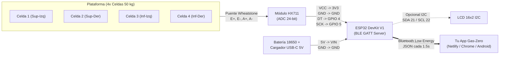

# Guía de Hardware, Compras y Conexiones — Gas-Zero (Desde Cero)

Esta guía está pensada para armar la báscula física de **Gas-Zero** paso a paso, **sin experiencia previa en Arduino ni electrónica**.

---

## 1. Lista exacta de compras (BOM)

Todo se consigue fácilmente en Mercado Libre, Amazon o tiendas de electrónica locales (~$25–$35 USD en total):

| # | Componente | Qué buscar exactamente | Cant. | Notas para principiantes |
|---|---|---|---|---|
| 1 | **ESP32 DevKit V1** | `ESP32 DevKit V1 30 pines USB-C` (o Micro-USB) | 1 | Trae Bluetooth BLE integrado. Verifica que tu cable USB transfiera **datos** (no solo carga). |
| 2 | **Kit 4 celdas de carga 50 kg + HX711** | `4x Celda de carga 50kg medio puente + Modulo HX711` | 1 kit | Suelen venderse juntos (soportan hasta **200 kg** combinadas). |
| 3 | **Combinador de celdas (Muy recomendado)** | `Placa combinadora celdas de carga` *(o protoboard pequeña)* | 1 | Evita tener que empalmar cables a mano para formar el puente de Wheatstone. |
| 4 | **Cables Dupont** | `Cables Dupont hembra-hembra` (20 cm) | 1 paquete | Para conectar HX711 ↔ ESP32 sin soldar. |
| 5 | **Batería Li-Ion 18650 + Shield 5V USB-C** | `Bateria 18650 3000mAh` + `Modulo 18650 Battery Shield V3` *(o TP4056 + elevador MT3608 a 5V)* | 1 | **Tip clave:** El *Battery Shield V3* ya trae cargador USB-C + protección + salida estable de **5V** lista para alimentar el ESP32 por `VIN`. |
| 6 | **Base metálica / madera rígida** | Dos placas rígidas (ej. acero o MDF grueso) con 4 soportes para las celdas | 1 | Las 4 celdas van en las 4 esquinas; la placa superior apoya solo en el botón central de cada celda. |
| 7 | *(Opcional)* **Pantalla LCD 16x2 I2C** | `LCD 1602 con modulo adaptador I2C soldado` | 1 | Solo si quieres ver peso/% directamente en la caja IP65 sin sacar el celular. |

---

## 2. Diagrama general de conexiones

---

## 3. Cómo unir las 4 celdas de carga de 50 kg (Puente de Wheatstone)

Cada celda de carga tiene **3 cables**: **Rojo** (centro), **Blanco** y **Negro**.

Imagina tu báscula vista desde arriba con 4 esquinas (**C1** arriba-izq, **C2** arriba-der, **C3** abajo-izq, **C4** abajo-der):

1. **Uniones entre celdas (no van al HX711, solo se juntan entre sí):**
   - Une **Negro de C1** con **Negro de C2**.
   - Une **Negro de C3** con **Negro de C4**.
   - Une **Blanco de C1** con **Blanco de C3**.
   - Une **Blanco de C2** con **Blanco de C4**.
2. **Los 4 cables ROJOS van al módulo HX711:**
   - **Rojo de C1** → pin **`E+`** del HX711
   - **Rojo de C4** *(esquina diagonal opuesta)* → pin **`E-`** del HX711
   - **Rojo de C2** → pin **`A+`** del HX711
   - **Rojo de C3** *(esquina diagonal opuesta)* → pin **`A-`** del HX711

> **Nota mecánica importante:** En cada celda, el centro sobresale ligeramente al recibir peso. Asegúrate de dejar un pequeño espacio hueco debajo del centro de cada celda (usando separadores o soportes impresos en 3D / rondanas) para que pueda flexionarse al cargarle el cilindro.

---

## 4. Tabla de pines: HX711 y Alimentación → ESP32

> ⚠️ **Regla de oro de seguridad:** Alimenta el módulo **HX711** desde **`3V3`** del ESP32 (no desde `5V`), porque los pines GPIO del ESP32 trabajan a **3.3V**.

| Módulo | Pin del módulo | Pin en ESP32 DevKit V1 |
|---|---|---|
| **HX711** | `VCC` | `3V3` |
| **HX711** | `GND` | `GND` |
| **HX711** | `DT` *(DOUT)* | `GPIO 4` *(D4)* |
| **HX711** | `SCK` *(PD_SCK)* | `GPIO 5` *(D5)* |
| **Alimentación 5V** *(Shield 18650 o TP4056+MT3608)* | `5V+` | `VIN` |
| **Alimentación 5V** | `GND` | `GND` |
| **LCD 16x2 I2C** *(Opcional)* | `VCC` / `GND` / `SDA` / `SCL` | `VIN` / `GND` / `GPIO 21` / `GPIO 22` |

---

## 5. Cómo subir el firmware al ESP32 (en 5 minutos)

1. **Instala Arduino IDE 2.x** desde https://www.arduino.cc/en/software.
2. **Agrega soporte para ESP32:**
   - En Arduino IDE ve a **Archivo → Preferencias**.
   - En *URLs adicionales de Gestor de Tarjetas* pega:
     `https://raw.githubusercontent.com/espressif/arduino-esp32/gh-pages/package_esp32_index.json`
   - Ve al ícono **Gestor de Tarjetas** (barra izquierda), busca **`esp32`** (by *Espressif Systems*) e instálalo.
3. **Instala la librería del sensor HX711:**
   - Ve al ícono **Gestor de Bibliotecas** (barra izquierda), busca **`HX711 Arduino Library`** (de *Bogdan Necula*) e instálala.
4. **Selecciona tu placa:**
   - Conecta el ESP32 a tu PC por USB.
   - En el selector superior elige **DOIT ESP32 DEVKIT V1** y el puerto **COM** que apareció.
   *(Si no aparece ningún COM, instala el driver USB CP2102 o CH340 según el chip negro pequeño cerca del puerto USB del ESP32.)*
5. **Paso A — Calibrar una sola vez:**
   - Abre `firmware/calibracion_hx711/calibracion_hx711.ino` y dale **Subir** (flecha `→`).
   - Abre el **Monitor Serie** (arriba a la derecha) a **`115200 baudios`**.
   - Con la báscula vacía escribe `t` + Enter.
   - Pon encima un peso conocido (ej. garrafón lleno de 10 kg o 20 kg) y escribe `10.0` + Enter.
   - Copia el **Factor de Escala** que te imprime.
6. **Paso B — Subir el firmware final de Gas-Zero:**
   - Abre `firmware/gas_zero_esp32/gas_zero_esp32.ino`.
   - Reemplaza `22800.0f` en la línea `float scaleFactor = 22800.0f;` por tu factor (o envíalo luego por Monitor Serie con `F <tu_numero>`).
   - Dale **Subir** (`→`). El ESP32 comenzará a anunciarse por Bluetooth como **`GasZero-001`**.

---

## 6. Conectar tu ESP32 físico a tu App Web en Netlify

1. Abre tu URL de **Gas-Zero** en **Chrome o Edge** (en Windows, Mac o celular Android).
2. Ve a la pestaña **BLE / Ajustes**.
3. Pulsa **"Escanear y conectar ESP32 (BLE)"**.
4. En la ventana de Bluetooth elige **`GasZero-001`** y toca **Emparejar**.
5. ¡Listo! Verás el peso real del HX711 en tiempo real, el LED azul del ESP32 quedará encendido y los botones **Forzar lectura**, **Aplicar tara** y el **selector de gas/tara** se sincronizarán directamente con tu ESP32.
